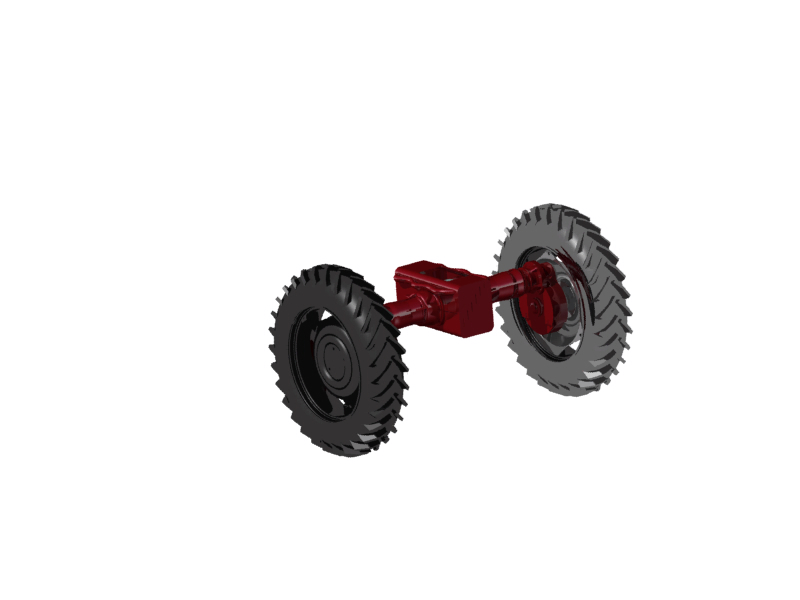
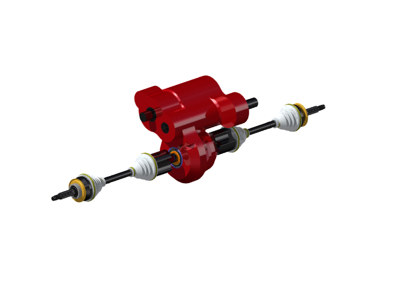
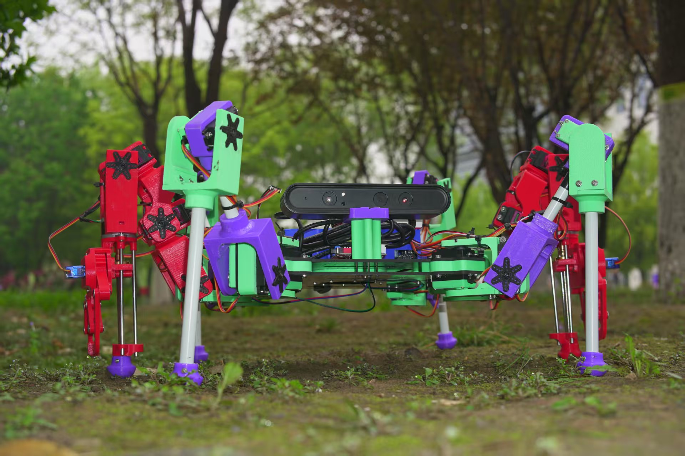
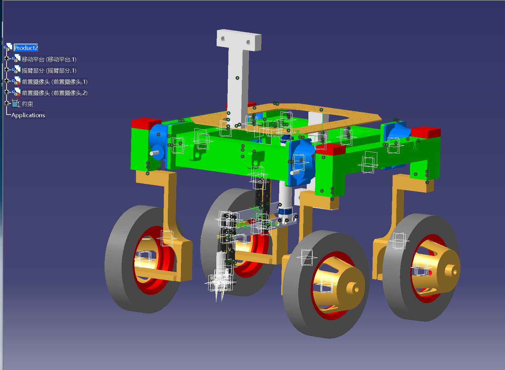

# 机械设计与三维建模作品集

本作品集收录机械设计作品图片，以及 2024 届成图大赛机械手臂建模的 CATIA、STEP 模型与装配说明书。

## 作品导航

| 作品 | 展示与资料 |
| --- | --- |
| 东方红30后桥 | [查看图片](东方红30后桥.jpg) |
| 混动传动系统 | [查看图片](混动传动系统.jpg) |
| 新型六足机器人 | [查看图片](新型六足机器人.jpg) |
| 自动化除草机器人 | [查看图片](自动化除草机器人.png) |
| 机械手臂建模 | [模型文件](2024届成图大赛机械手臂建模/) · [装配说明书](机械手建模装配说明书.pdf) |

## 东方红30后桥

## 混动传动系统

## 新型六足机器人

## 自动化除草机器人

## 2024届成图大赛机械手臂建模

- [机械手建模装配说明书（PDF）](机械手建模装配说明书.pdf)
- [查看全部模型文件](2024届成图大赛机械手臂建模/)
- [机械手装配文件（CATProduct）](2024届成图大赛机械手臂建模/jixieshou.CATProduct)
- [机械手交换模型（STEP）](2024届成图大赛机械手臂建模/jixieshou.stp)

### 模型使用说明

通过仓库顶部 **Code → Download ZIP** 下载完整作品集并解压。打开 CATIA 装配文件时，请保留模型目录中的原始文件名和相对位置，以便查找零件引用。STEP 文件可使用支持该格式的 CAD 软件打开。
